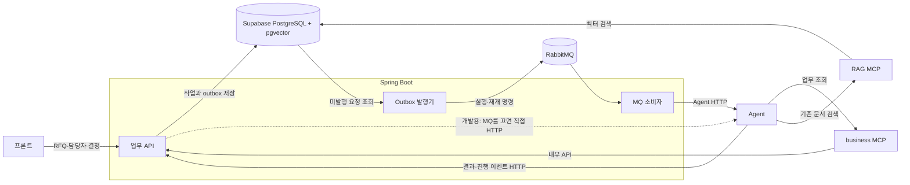

# SupplySync
> 고객 사양서가 우리 제품에 맞는지에 더해, **필요한 부품을 확보해 그 가격과 납기에 실제로 공급할 수 있는지**까지 검토하는 B2B RFQ 대응 AI Agent

## 목차
1. [프로젝트 개요](#1-프로젝트-개요)
2. [데모 시나리오](#2-데모-시나리오)
3. [시스템 구성](#3-시스템-구성)
4. [Agent 워크플로](#4-agent-워크플로)
5. [레포지토리 구성](#5-레포지토리-구성)
6. [팀 구성](#6-팀-구성)

---

## 1. 프로젝트 개요

| 항목 | 내용 |
|---|---|
| 과정 | AI Agent 캡스톤 |
| 기간 | 2026.10.19 ~ 2026.10.21 |
| 주제 | 공급망 연계 RFQ·재고·구매 대응 Agent (B2B 제조) |
| 사용자 | 제조기업 영업팀·설계팀·구매팀 |

### 문제
부품사는 고객(완성차)의 견적요청서(RFQ)를 받으면 사양 검토, 재고 확인, 대체 부품 검토, 견적 작성을 여러 부서가 나눠 처리합니다. 사양이 맞아도 **기존 주문에 배정된 재고를 빼면 핵심 부품이 부족**하거나 입고가 늦어, 제시한 납기를 지키지 못하는 경우가 생깁니다.

### 해결
RFQ 접수부터 견적 등록까지를 하나의 Agent 흐름으로 연결합니다.

- **사양 검토**: RFQ의 이상값·누락을 찾고, 표준 모델과 옵션으로 고객 요구를 맞출 수 있는지 판단
- **공급 검토**: 옵션까지 반영한 부품 목록으로 가용 재고와 입고 일정을 확인하고, 부족하면 대안을 비교
- **견적 작성**: 단가·마진·연간 인하·조건을 규정에 맞춰 작성하고 검증
- **사람 확인**: 판단이 필요한 두 지점(가정값 확인, 견적 승인)에서 멈추고 담당자 결정을 받음

판정과 숫자 계산은 DB 값과 규칙(rules.yaml)으로 하고, LLM은 문서 추출·해석·문장 작성만 맡습니다. 모든 판단에는 사내 규정·설계 기준의 근거 조항(RAG)을 함께 보여줍니다.

---

## 2. 데모 시나리오

완성차 **한별모터스**가 전기 SUV용 전동식 워터펌프 RFQ를 부품사 **대성오토텍**에 보냅니다. (모든 회사·제품·수치는 가상입니다.)

| 단계 | 결과 |
|---|---|
| SG1 RFQ 검토 | 이슈 7건 검출. 유량 "22 L/h" 단위 오기에서 멈춤 → 담당자가 22 L/min으로 확정 → 중형 모델 EWP-12-B + 고온·방수 옵션 2개 추천 |
| SG2 공급 분석 | 고온 옵션이 쓰는 제어칩이 기존 주문 배정분을 빼면 **500개 부족**, 입고는 납기보다 36일 늦음 → 다른 공급사의 대체 칩 500개 추천 |
| SG3 견적 작성 | 단가 37,300원 (목표가 38,000원 이내), 마진·연간 인하·형식 검증 5개 통과, 대체 칩 비용은 별도 표시 |
| SG4 승인·등록 | 담당자 승인 → 재고 재확인 → 견적 등록 |

---

## 3. 시스템 구성

- Agent는 DB에 직접 접근하지 않습니다. 모든 데이터는 MCP 도구로 받고, MCP 서버는 Spring 내부 API를 거칩니다.
- 사람 확인이 필요한 지점에서 Agent가 멈추면, Spring이 담당자 결정을 받아 실행을 재개합니다.

---

## 4. Agent 워크플로

| SG | 이름 | 하는 일 | 사람 확인 |
|---|---|---|---|
| SG1 | RFQ·제품 검토 | RFQ 추출 → 누락·이상값 검증 → 모델·옵션 매칭 → 계약 조건 검토 | 가정값 확인 |
| SG2 | 공급·대안 분석 | 옵션 반영 BOM → 가용 재고·입고 일정 확인 → 부족 시 대안 4가지 비교·추천 | |
| SG3 | 견적 작성·검증 | 단가·연도별 단가·마진 계산 → 조건부 사항 작성 → 검증 5항목 | |
| SG4 | 승인·등록 | 담당자 승인 → 재고 재확인 → 견적 등록 | 견적 승인 |

### MCP 도구

| 서버 | 도구 |
|---|---|
| business-mcp | get_rfq_content, get_models, get_options, get_bom, check_parts_supply, get_parts_cost, save_review, save_quote, register_quote |
| rag-mcp | search_docs, get_chunk (Resource) |

---

## 5. 레포지토리 구성

| 레포지토리 | 역할 | 주요 기술 
|---|---|---|
| SupplySync-AI | LangGraph Agent 서버 (SG1~4, 실행·재개 API) | Python, LangGraph, FastAPI 
| SupplySync-BE | 업무 API, 인증·권한, 실행 관리, 내부 API | Spring Boot, PostgreSQL
| SupplySync-Business-MCP | 업무 데이터 MCP 서버 | Spring AI MCP 
| SupplySync-RAG-MCP | 사내 문서 검색 MCP 서버 | bge-m3
| SupplySync-FE | 담당자·고객 화면

---

## 6. 팀 구성

| 이름 | 역할 | 담당 |
|---|---|---|
| 윤서준 | 팀장 / AI | 총괄, SG2 공급·대안 분석, rag-mcp |
| 김지영 | AI | SG1 RFQ·제품 검토 |
| 박영신 | AI, MCP | SG3 견적 작성·검증, business-mcp |
| 신주윤 | AI | SG4 승인·등록 |
| 김태건 | Backend | Spring API, DB |
| 이정현 | Frontend, 발표자료 | 화면, PPT 작성 |
